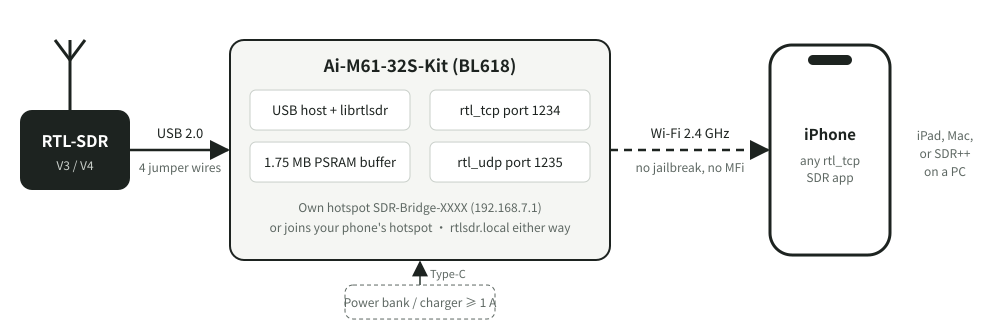
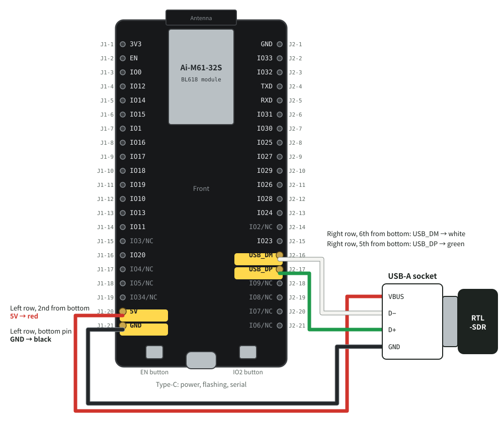

# rtlsdr-iphone-bridge

**English** | [中文](README.zh-CN.md)

Turn an RTL-SDR into an `rtl_tcp` server on Wi-Fi, using a development board that costs a few dollars and
**needs no soldering**. Any `rtl_tcp` SDR app on an iPhone joins the board's Wi-Fi, enters one address, and receives.



## Why

An iPhone that is not jailbroken cannot drive an RTL-SDR. The RTL-SDR is a USB bulk-transfer device, and iOS gives
ordinary apps neither libusb nor IOKit; DriverKit exists only on M-series iPads. This is a limit of the iOS
architecture, not of App Store review. So every SDR app on the App Store is a **network client**: the RTL-SDR
plugs into another machine running `rtl_tcp`, and the phone connects to it over the network.

The trouble is the other machine. A laptop is too big. A Raspberry Pi needs an SD card and an operating system,
takes half a minute to boot and draws several watts. To take a phone to an airport for ADS-B or up a hill for APRS
you want something that **fits in a pocket, runs from a power bank, and works a few seconds after power-on**.

That is what this is:

- **The board**: Ai-Thinker's Ai-M61-32S-Kit (Bouffalo BL618), with a high-speed USB host port, Wi-Fi and
  4 MB of PSRAM, for a few dollars.
- **The wiring**: four jumper wires to a USB-A socket, and the RTL-SDR plugs into that. No soldering iron.
- **Using it**: at power-on the board starts its own Wi-Fi hotspot. Join it from the phone and enter
  `rtlsdr.local` (or `192.168.7.1`) in the app. Or let the board join the phone's Personal Hotspot instead,
  so the phone keeps its internet connection.
- **The protocols**: port 1234 is unmodified `rtl_tcp`, so existing apps work without a single change.
  Port 1235 also offers `rtl_udp`, for clients that want to know exactly which samples were lost.
- **The licence stays off the phone**: the firmware contains librtlsdr and is therefore GPL. Between an app and the
  board there is only a network protocol, so the app contains none of this code and App Store distribution is
  unaffected.

Computers work too: SDR++, GQRX and anything else that speaks `rtl_tcp` take the same address.

## How fast

Wi-Fi is the narrowest part of the path. The BL618 has one antenna on 2.4 GHz with 20 MHz channels, and sustains a
little over 30 Mbit/s in practice. RTL-SDR I/Q is two bytes a sample, so 2.4 MSPS is 38.4 Mbit/s, right at the
edge. Measured with the board running its own hotspot and the receiver connected directly:

| Use | Sample rate | Data rate | Measured |
|---|---|---|---|
| FM broadcast, airband, amateur bands | 1.024 MSPS | 16.4 Mbit/s | nothing lost |
| Wider spectrum | 2.0 MSPS | 32 Mbit/s | nothing lost (with the board placed well) |
| Widest | 2.4 MSPS | 38.4 Mbit/s | 80–95% delivered; the rest is dropped on the board and the client is told where |
| ADS-B (`rtl_udp`, magnitudes only) | 2.0–2.4 MSPS | 16–19 Mbit/s | nothing lost |

Things that halve the throughput: **Bluetooth on the receiving device** (it shares 2.4 GHz airtime with Wi-Fi;
measured 29 down to 15 Mbit/s), **jumper wires or a hand close to the board's antenna**, and distance.
For I/Q, stay at 2.0 MSPS or below.

Why UDP does not fill the link either: UDP itself waits for no acknowledgement, but Wi-Fi does. Every unicast frame
must be acknowledged by the receiver or it is retransmitted; that is 802.11, and no protocol above it avoids it.
Broadcast frames are not acknowledged, but they go at the 1–6 Mbit/s basic rate, which is slower still.

## Known issue

While Wi-Fi runs, something outside the CPU (most likely the Wi-Fi hardware) zeroes one fixed
4-byte word of PSRAM, at `0xa8201300`, every few minutes. The firmware keeps no samples there: a
1 MB guard covers that address, and the boot log says `ring guard covers 0xa8201300`. Reported
upstream as [bouffalo_sdk#272](https://github.com/bouffalolab/bouffalo_sdk/issues/272); the
details are in [firmware/bl618_rtl_udp/README.md](firmware/bl618_rtl_udp/README.md) (in Chinese).

## What you need

| Item | Notes | Approx. |
|---|---|---|
| **Ai-M61-32S-Kit** | Ai-Thinker's own development board, chip **BL618**, with 4 MB PSRAM. Listings that say "BL616" are the Ai-M62, which **has no PSRAM and will not work** | US$5–8 |
| **USB-A female to 4-pin jumper cable** | A USB-A socket on one end and four separate 2.54 mm female jumper connectors on the other (sold for motherboard headers). **Not the 9-pin kind**, which is for a two-row header. Shorter is better | US$1–2 |
| **RTL-SDR** | RTL-SDR Blog V3, V4, or any other RTL2832U stick | — |
| **Type-C cable and power** | To a computer for flashing; to a power bank or charger otherwise, **at least 5 V 1 A** (about 500 mA for the board, 250–300 mA for the RTL-SDR) | — |
| Antenna | The one that came with the RTL-SDR is fine to start | — |

The board's Type-C port already has a USB-serial chip (CH340C) behind it, used for flashing and for the log, so
**no separate serial adapter is needed**.

Building needs an **x86_64 Linux** machine (physical, virtual or cloud; CentOS Stream 9 is the one verified), for the
reason under [Build](#build). Flashing works from Linux or from a Mac.

## Wiring



Lay the board **front side up, antenna at the top, Type-C at the bottom**, and connect four wires:

| USB-A socket | Board pin (silkscreen) | Where on the board | Usual wire colour |
|---|---|---|---|
| VBUS | `5V` | left row, 2nd from the bottom | red |
| GND | `GND` | left row, bottom pin | black |
| D− | `USB_DM` | right row, 6th from the bottom (the pin above it is `IO23`) | white |
| D+ | `USB_DP` | right row, 5th from the bottom (the pin below it is `IO9/NC`) | green |

Before powering up:

1. **Unplug the Type-C cable** while wiring, and plug it back in only when all four wires are on.
2. **Do not swap 5V and GND**: that can destroy the RTL-SDR. Trust your own cable over any colour code; if in doubt,
   check the socket with a multimeter. The two outer contacts are VBUS and GND, the two inner ones are data.
3. Swapping `USB_DM` and `USB_DP` damages nothing; the RTL-SDR is simply not recognised. Swap them back.
4. The data pair carries 480 Mbit/s. Keep the two wires **together and as short as possible**.
5. The same names are printed on the back of the board, but seen from the back the two rows swap sides.
   Go by the front.

The RTL-SDR is powered from the board's `5V` pin through a diode, so it gets a few tenths of a volt less than 5 V.
RTL-SDRs normally accept that. If it is not recognised, or keeps disconnecting, suspect power first: use a stronger
charger, or measure the voltage on the `5V` pin.

## Build

The firmware builds only on **x86_64 Linux**. The Wi-Fi library in Bouffalo's SDK is shipped as GCC 10.2 LTO
bytecode, which links only with Bouffalo's XuanTie GCC **v2.6.1** (the newer v2.10.2 refuses it), and v2.6.1 exists
only for x86_64 Linux. WSL2 on Windows may work; it has not been tried.

```bash
git clone https://github.com/nasacj/rtlsdr-iphone-bridge.git
cd rtlsdr-iphone-bridge

# Bouffalo's SDK (about 2 GB) and XuanTie GCC v2.6.1, pinned, into firmware/deps/
firmware/tools/fetch-deps.sh bl618

export PATH=$PWD/firmware/deps/xuantie-gcc-2.6.1/bin:$PATH
cd firmware/bl618_rtl_udp
make
```

The result is `firmware/bl618_rtl_udp/build/build_out/bl618_rtl_udp_bl616.bin`, about 1.1 MB.
The system needs `git`, `make`, `cmake`, `curl` and `xz`.

To change the Wi-Fi settings before building, see [Wi-Fi settings](#wi-fi-settings). The defaults work as they are.

## Flash

**1. Put the board in download mode.** The kit has no automatic download circuit, so this is by hand every time:

> hold **IO2** → press and release **EN** → release IO2

The two buttons sit either side of the Type-C port: EN on the left, IO2 on the right (see the wiring diagram).

**2. Write the firmware.** The serial port is usually `/dev/ttyUSB0` on Linux and `/dev/tty.usbserial-XXXX` or
`/dev/tty.wchusbserial-XXXX` on a Mac. Run `ls /dev/tty*` before and after plugging the board in; the new one is it.

On the Linux machine that built it:

```bash
cd firmware/bl618_rtl_udp
make flash COMX=/dev/ttyUSB0 BAUDRATE=500000
```

**Give the baud rate**: the SDK defaults to 2 Mbaud, and the board's CH340C flashes at 500 kbaud at most.

With the board plugged into a Mac (building still happens on Linux):

```bash
firmware/tools/fetch-deps.sh bl618                 # on a Mac this fetches only the flasher, about 76 MB
echo my-linux-box > firmware/tools/build-host      # ssh name of the build machine; not committed
firmware/tools/flash-bl618.sh /dev/tty.usbserial-XXXX
```

`flash-bl618.sh` copies the build from the build machine and flashes it. `BL618_HOST=...` works instead of the
`build-host` file.

**3. Press EN** and the new firmware runs.

If flashing stalls at the write step and times out after 30 seconds, set `decompress_write = false` in the flasher's
`chips/bl616/eflash_loader/eflash_loader_cfg.ini`, unplug and replug the board, and try again. The flasher compresses
the image by default and the board must decompress it and acknowledge within 30 seconds, which a larger image may
not manage at 500 kbaud.

Reflashing does **not** change the Wi-Fi password: it lives in a separate part of the flash that flashing leaves alone.

## First boot: the Wi-Fi name and password

By default the board **starts its own hotspot**, named `SDR-Bridge-` plus four hex digits of the chip ID, for example
`SDR-Bridge-3F2A`. **Every board has its own password**: twelve characters drawn from the chip's hardware random
number generator on first boot, stored in flash, and the same on every boot after that.

The password is printed only on the serial log. Connect the board's Type-C to a computer, open the serial port at
**2,000,000 baud**, and press EN:

```bash
tio -b 2000000 /dev/ttyUSB0                  # Linux (or: picocom -b 2000000 /dev/ttyUSB0)
tio -b 2000000 /dev/tty.usbserial-XXXX       # Mac: brew install tio
```

The boot log has a line like this:

```
[wifi] network "SDR-Bridge-3F2A" up, password xxxxxxxxxxxx
```

Note the name and the password, and you will not need a computer again.

Why not a fixed password: `rtl_tcp` has no authentication at all. Anyone on the Wi-Fi can retune the receiver and
read every sample, so the Wi-Fi password is the only lock there is. A fixed password published in an open-source
repository is no lock, and one derived from the chip ID is no better, because the chip ID is in the MAC address the
board broadcasts.

## Wi-Fi settings

The Wi-Fi settings live in `firmware/bl618_rtl_udp/wifi_secrets.h`. It is not committed; start from the template:

```bash
cd firmware/bl618_rtl_udp
cp wifi_secrets.h.example wifi_secrets.h
```

The settings are compiled in, so **rebuild and reflash** after changing them.

**Choose the hotspot password yourself:**

```c
#define BRIDGE_STA_SSID ""                  // empty: the board keeps starting its own hotspot
#define BRIDGE_STA_KEY  ""
#define BRIDGE_AP_KEY   "my-password-123"   // 8 to 63 characters
```

**Have the board join your phone's Personal Hotspot** (the phone keeps its internet):

```c
#define BRIDGE_STA_SSID "Jane’s iPhone"     // exactly as Settings shows it, curly ’ included
#define BRIDGE_STA_KEY  "hotspot password"
```

- At power-on the board tries that network, and **falls back to its own hotspot after 20 seconds**, so a typo
  cannot lock you out.
- On the phone's hotspot the board's address is assigned by the phone; the `got ip` line in the serial log shows it
  (an iPhone hotspot is usually `172.20.10.x`). Enter `rtlsdr.local` in the app and the address does not matter.
- The BL618 is **2.4 GHz only**. On an iPhone, turn on **Maximize Compatibility** for the Personal Hotspot; on a
  home router, use its 2.4 GHz network name.

**A password that has been given away** (when `BRIDGE_AP_KEY` is not set): type `bridge_ap_newkey` on the serial
console, press EN to restart, and the board draws and prints a new random password.

## Connect an app

1. Join the phone to `SDR-Bridge-XXXX` (or let the board join the phone's hotspot, as above).
   The board's hotspot has no internet; iOS keeps using mobile data for that, so other apps are unaffected.
2. In an `rtl_tcp` SDR app, enter the server **`rtlsdr.local`**, port **`1234`**.
   If `rtlsdr.local` does not resolve, use **`192.168.7.1`** (the board's address on its own hotspot).
3. The first time, iOS asks whether the app may access the local network. Allow it.

One client is served at a time, and a new connection replaces the old one (which is what an app reconnecting does).

## Status lights

Away from a computer, running from a power bank, the lights tell you what the board is doing. There is an RGB light
and two single-colour lights, a yellow one marked **W** and a white one marked **C** on the silkscreen.
All three use the same language:
**slow blink = waiting, steady = ready, breathing = working, fast blink = trouble.**

| Light | Answers | Slow blink | Steady | Breathing | Fast blink |
|---|---|---|---|---|---|
| **Yellow (W)** | Is the RTL-SDR OK? | no RTL-SDR plugged in | RTL-SDR ready | — | plugged in but cannot be opened, or USB delivers nothing |
| **White (C)** | How far have Wi-Fi and the phone got? | Wi-Fi up, waiting for a phone | phone connected, not streaming | streaming | — |
| **RGB** | Is the stream healthy? | — | red: Wi-Fi not up yet | blue: streaming, all well | red/blue: data lost on the USB side; purple/blue: Wi-Fi cannot keep up, data lost |

- White **off** means Wi-Fi is not up yet.
- The RGB light is off when nothing is streaming and nothing is wrong. When a stream ends by itself it shows
  **red for 3 seconds**; the reason is on the serial log's `session ended:` line.
- Walking around with the board, **where it flashes purple and blue is where Wi-Fi is not enough**: move closer, or
  lower the sample rate.

## Check for lost samples yourself

`firmware/tools/rtl_tcp_counter.py` puts the RTL-SDR in test mode, where the chip sends an incrementing counter
instead of samples, and checks every byte on the computer, so one byte lost anywhere between USB and Wi-Fi shows.
It needs only Python 3:

```bash
firmware/tools/rtl_tcp_counter.py 192.168.7.1 --udp --rate 2.0M --seconds 60
```

A last line of `PASS: every sample, in place, at the full rate` means nothing was lost. With no RTL-SDR plugged in
the board generates the same counter itself, so the Wi-Fi half can be tested on its own. The full test sequence and
the measurements are in [firmware/bl618_rtl_udp/README.md](firmware/bl618_rtl_udp/README.md) (in Chinese).

## Layout

```
firmware/
  bl618_rtl_udp/      BL618 firmware: CherryUSB host + librtlsdr + lwIP + Wi-Fi; details in its README
  teensy41_rtl_tcp/   the wired alternative: Teensy 4.1 over Ethernet (builds, not yet run on a board)
  common/librtlsdr/   unmodified librtlsdr, shared by both firmwares
  tools/              fetching dependencies, building, flashing, the counter test
  tests/              unit tests that run on a computer
docs/images/          the diagrams on this page
```

Besides Wi-Fi there is a wired route in this repository: a Teensy 4.1 with Ethernet, into the iPhone through a
USB-C Ethernet adapter. It is steadier and faster, but needs soldering and an adapter to carry.
See [firmware/teensy41_rtl_tcp/README.md](firmware/teensy41_rtl_tcp/README.md). The deeper documents are in Chinese.

## Licence

The firmware contains librtlsdr (GPL-2.0-or-later), so **the BL618 firmware as a whole is GPL-2.0-or-later**;
see [LICENSE](LICENSE). Bouffalo's SDK and CherryUSB (Apache-2.0), lwIP (BSD) and FreeRTOS (MIT) are all compatible.
The Teensy firmware uses QNEthernet (AGPL-3.0-or-later) and is AGPL-3.0-or-later as a whole.

This binds only the firmware on the board. Apps on a phone or a computer talk to the board through the `rtl_tcp` and
`rtl_udp` network protocols and contain none of this code.
