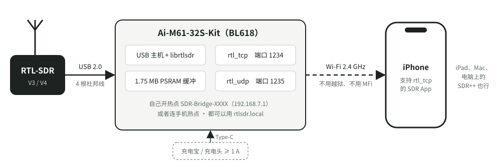
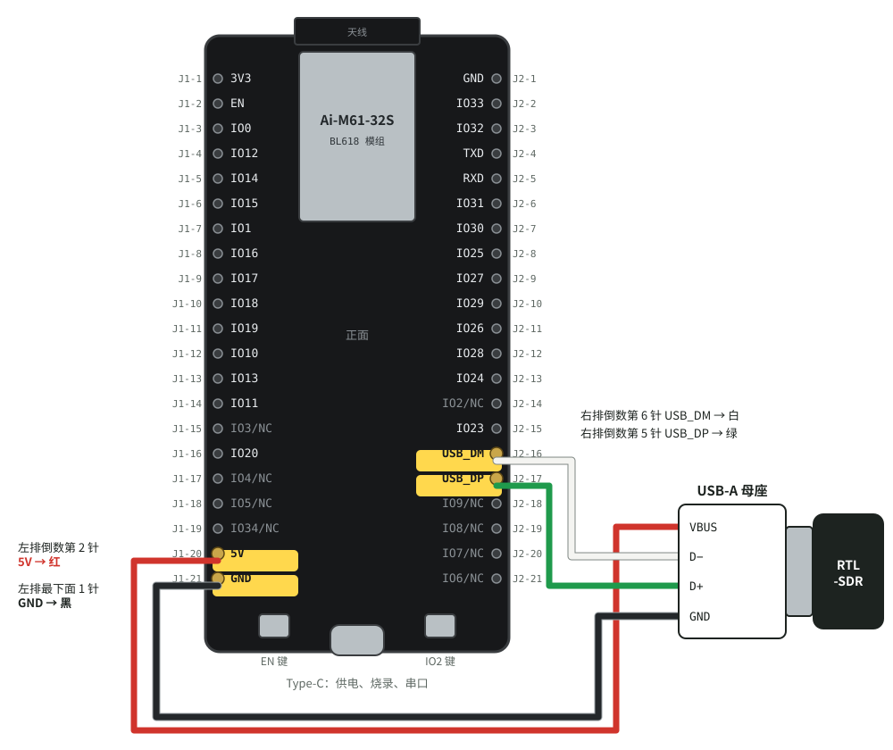

# rtlsdr-iphone-bridge

[English](README.md) | **中文**

把 RTL-SDR 变成一个 Wi-Fi 上的 `rtl_tcp` 服务器，用的是一块几十块钱的开发板，**不用焊接**。
iPhone 上支持 `rtl_tcp` 的 SDR App 连上板子的 Wi-Fi，填一个地址就能收信号。



## 为什么做这个

iPhone 没有越狱就驱动不了 RTL-SDR。RTL-SDR 是 USB 批量传输设备，而 iOS 不让普通 App 用 libusb 或 IOKit，
DriverKit 也只在 M 系列芯片的 iPad 上才有。这是 iOS 架构上的限制，和 App Store 审核无关。所以 App Store 里的
SDR App 全都是**网络客户端**：RTL-SDR 插在另一台机器上，那台机器跑 `rtl_tcp`，手机通过网络去连。

问题在于"另一台机器"。笔记本太大；树莓派要 SD 卡和系统，开机要等半分钟，还要好几瓦的电。
想带着手机去机场听 ADS-B、去山顶收 APRS，需要的是一个**口袋里放得下、充电宝就能带、插电几秒就能用**的东西。

这个项目就是那个东西：

- **板子**：安信可 Ai-M61-32S-Kit（博流 BL618 芯片），自带 USB 高速主机口、Wi-Fi 和 4 MB PSRAM，几十块钱。
- **接线**：四根杜邦线接一个 USB-A 母座，RTL-SDR 插上去，不用拿烙铁。
- **用法**：板子开机后自己开一个 Wi-Fi 热点，手机连上去，App 里填 `rtlsdr.local`（或 `192.168.7.1`）。
  也可以让板子去连手机的个人热点，这样手机还能同时上网。
- **协议**：端口 1234 是原样的 `rtl_tcp`，现有的 App 一行代码都不用改；端口 1235 另外提供 `rtl_udp`，
  给想精确知道丢了哪些采样的客户端用。
- **许可证不跟着进手机**：板子上的固件包含 librtlsdr，所以是 GPL；手机 App 和板子之间只有网络协议，
  App 不包含这里的任何代码，上架 App Store 不受影响。

电脑也能用：SDR++、GQRX 这些支持 `rtl_tcp` 的软件填同样的地址就行。

## 能跑多快

Wi-Fi 是这条路上最窄的地方。BL618 是单天线 2.4 GHz、20 MHz 信道，实际能稳定跑到 30 多 Mbit/s。
RTL-SDR 的 I/Q 每个采样 2 字节，2.4 MSPS 就是 38.4 Mbit/s，刚好卡在边上。实测（板子自己开热点，接收端直连）：

| 用法 | 采样率 | 数据量 | 实测 |
|---|---|---|---|
| FM 广播、航空波段、业余无线电 | 1.024 MSPS | 16.4 Mbit/s | 零丢失 |
| 宽一点的频谱 | 2.0 MSPS | 32 Mbit/s | 零丢失（摆放好的时候） |
| 最宽 | 2.4 MSPS | 38.4 Mbit/s | 送到 80–95%，其余在板子上丢掉，丢在哪里会告诉客户端 |
| ADS-B（`rtl_udp` 只发幅度） | 2.0–2.4 MSPS | 16–19 Mbit/s | 零丢失 |

会让速度掉一半的几件事：**接收端开着蓝牙**（2.4 GHz 和 Wi-Fi 抢空口，实测吞吐从 29 掉到 15 Mbit/s）、
**杜邦线或手贴着板子的天线**、距离太远。I/Q 建议用 2.0 MSPS 以下。

为什么 UDP 也跑不满：UDP 本身不等确认，但 Wi-Fi 这一层每发一帧都要对方回一个确认（ACK），
收不到就重传。这是 802.11 的规定，换协议绕不开。广播帧不用确认，可它只能按 1–6 Mbit/s 的基本速率发，更慢。

## 已知问题

Wi-Fi 运行时，CPU 以外的某个东西（最可能是 Wi-Fi 硬件）每隔几分钟会把 PSRAM 里固定地址 `0xa8201300`
上的 4 个字节写成 0。固件不在那里放采样数据：用 1 MB 保护区盖住了这个地址，开机日志会打
`ring guard covers 0xa8201300`。已报给博流：[bouffalo_sdk#272](https://github.com/bouffalolab/bouffalo_sdk/issues/272)，
排查过程见 [firmware/bl618_rtl_udp/README.md](firmware/bl618_rtl_udp/README.md#psram-里被-wi-fi-写坏的一个字)。

## 需要准备的东西

| 东西 | 说明 | 参考价 |
|---|---|---|
| **Ai-M61-32S-Kit** | 安信可官方开发板，芯片是 **BL618**，带 4 MB PSRAM。标题写"BL616"的是 Ai-M62，**没有 PSRAM，不能用** | ¥30–50 |
| **USB-A 母座转杜邦线** | 淘宝搜"杜邦 4P 2.54 转 USB 母 单口"：一头是 USB-A 母座，一头是 4 个单独的杜邦母头。**不要买 9 针的**（那是主板双排插座用的）。越短越好 | ¥5–15 |
| **RTL-SDR** | RTL-SDR Blog V3、V4 或其他 RTL2832U 的棒子都行 | 已有就行 |
| **Type-C 数据线 + 电源** | 烧录时接电脑；平时接充电宝或充电头，**至少 5 V 1 A**（板子约 500 mA，RTL-SDR 再要 250–300 mA） | 已有就行 |
| 天线 | RTL-SDR 自带的就能开始 | 已有就行 |

开发板的 Type-C 后面已经有 USB 转串口芯片（CH340C），烧录和看日志都走它，**不用另买串口模块**。

编译要一台 **x86_64 的 Linux**（实体机、虚拟机或云主机都行，验证过的是 CentOS Stream 9），原因见[编译](#编译)。
烧录在 Linux 或 Mac 上都可以。

## 接线



板子**正面朝上、天线在上、Type-C 在下**摆好，接四根线：

| USB-A 母座 | 开发板排针（丝印） | 在板上的位置 | 常见线色 |
|---|---|---|---|
| VBUS | `5V` | 左排倒数第 2 针 | 红 |
| GND | `GND` | 左排最下面 1 针 | 黑 |
| D− | `USB_DM` | 右排倒数第 6 针（它上面一针是 `IO23`） | 白 |
| D+ | `USB_DP` | 右排倒数第 5 针（它下面一针是 `IO9/NC`） | 绿 |

接之前看一遍：

1. **先拔掉 Type-C**，四根线都接好再插电。
2. **5V 和 GND 不能接反**，接反可能烧坏 RTL-SDR。线色以你手上那根线为准；不确定就用万用表量一下母座：
   最边上的两个触点是 VBUS 和 GND，中间两个是数据线。
3. `USB_DM` 和 `USB_DP` 接反不会坏东西，只是认不出 RTL-SDR，对调一下就好。
4. 数据线跑的是 480 Mbit/s 的高速信号，两根线**贴在一起走、越短越好**。
5. 板子背面也印着同样的名字，但翻过来看时左右两排是对调的，以正面为准。

RTL-SDR 的电来自板子的 `5V` 排针，前面有一个二极管，电压会比 5 V 低零点几伏。RTL-SDR 一般能接受；
插上后不识别或者反复断开，先怀疑供电：换一个电流更大的充电头，或者量一下 `5V` 排针的电压。

## 编译

固件只能在 **x86_64 Linux** 上编。博流 SDK 里预编译的 Wi-Fi 库是 GCC 10.2 生成的 LTO 中间代码，
只能用博流的 XuanTie GCC **v2.6.1** 链接（更新的 v2.10.2 会直接拒绝），而 v2.6.1 只有 x86_64 Linux 版。
Windows 用户可以试试 WSL2（没有验证过）。

```bash
git clone https://github.com/nasacj/rtlsdr-iphone-bridge.git
cd rtlsdr-iphone-bridge

# 取依赖：博流 SDK（约 2 GB）和 XuanTie GCC v2.6.1，都放在 firmware/deps/，版本固定
firmware/tools/fetch-deps.sh bl618

export PATH=$PWD/firmware/deps/xuantie-gcc-2.6.1/bin:$PATH
cd firmware/bl618_rtl_udp
make
```

编好的文件是 `firmware/bl618_rtl_udp/build/build_out/bl618_rtl_udp_bl616.bin`，大约 1.1 MB。
需要系统里有 `git`、`make`、`cmake`、`curl`、`xz`。

想先改 Wi-Fi 设置再编，看下面的 [Wi-Fi 设置](#wi-fi-设置)；不改也完全能用。

## 烧录

**1. 让板子进下载模式。** 这块板子没有自动下载电路，每次都要手按：

> 按住 **IO2 键**不放 → 短按一下 **EN 键** → 松开 IO2 键

两个键在 Type-C 两边，左边是 EN，右边是 IO2（见接线图）。

**2. 写进去。** 串口名：Linux 一般是 `/dev/ttyUSB0`，Mac 是 `/dev/tty.usbserial-XXXX` 或
`/dev/tty.wchusbserial-XXXX`。插板子前后各 `ls /dev/tty*` 一次，多出来的那个就是。

在编译的那台 Linux 上：

```bash
cd firmware/bl618_rtl_udp
make flash COMX=/dev/ttyUSB0 BAUDRATE=500000
```

**波特率一定要写 500000**：SDK 默认用 2 Mbaud，板载的 CH340C 烧录最多只能 500 kbaud。

板子插在 Mac 上时（编译仍然在 Linux 上）：

```bash
firmware/tools/fetch-deps.sh bl618                 # Mac 上只取烧录工具，约 76 MB
echo my-linux-box > firmware/tools/build-host      # 编译机的 ssh 名字，这个文件不提交
firmware/tools/flash-bl618.sh /dev/tty.usbserial-XXXX
```

`flash-bl618.sh` 会从编译机把编好的文件拉回来再烧；也可以用环境变量 `BL618_HOST=...` 代替 `build-host` 文件。

**3. 按一下 EN 键**，新固件就开始运行了。

烧录卡在写入那一步、30 秒后超时：把烧录工具目录里
`chips/bl616/eflash_loader/eflash_loader_cfg.ini` 的 `decompress_write` 改成 `false`，拔插一次板子的 USB 再试。
烧录工具默认先压缩再写，板子要在 30 秒内解压完并回一个确认，500 kbaud 下固件大一点就可能赶不上。

重新烧录**不会**改变 Wi-Fi 密码：密码存在 Flash 里单独的一块，烧录不擦它。

## 第一次开机：拿到 Wi-Fi 名字和密码

板子默认**自己开一个热点**，名字是 `SDR-Bridge-` 加 4 位芯片编号，比如 `SDR-Bridge-3F2A`。
**密码每块板子都不一样**：第一次开机时用芯片的硬件随机数生成 12 位密码，存在 Flash 里，以后每次开机都一样。

密码只打印在串口日志里。板子用 Type-C 接电脑，打开串口（**波特率 2000000**），再按一下 EN 键：

```bash
tio -b 2000000 /dev/ttyUSB0                  # Linux（或者 picocom -b 2000000 /dev/ttyUSB0）
tio -b 2000000 /dev/tty.usbserial-XXXX       # Mac：brew install tio
```

开机日志里有这样一行：

```
[wifi] network "SDR-Bridge-3F2A" up, password xxxxxxxxxxxx
```

把名字和密码记下来，以后就不用再接电脑了。

为什么不用固定密码：`rtl_tcp` 没有任何认证，连上 Wi-Fi 的人就能调台、拿走所有采样，Wi-Fi 密码是唯一的锁。
写在开源仓库里的固定密码等于没锁；用芯片编号算出来的也不行，芯片编号就在板子广播出去的 MAC 地址里。

## Wi-Fi 设置

Wi-Fi 设置在 `firmware/bl618_rtl_udp/wifi_secrets.h` 里。这个文件不提交到 git，从模板复制一份：

```bash
cd firmware/bl618_rtl_udp
cp wifi_secrets.h.example wifi_secrets.h
```

改完要**重新编译、重新烧录**，设置是编进固件里的。

**自己定热点密码：**

```c
#define BRIDGE_STA_SSID ""                 // 留空：板子照旧自己开热点
#define BRIDGE_STA_KEY  ""
#define BRIDGE_AP_KEY   "my-password-123"  // 8 到 63 个字符
```

**让板子去连手机的个人热点**（手机可以同时上网）：

```c
#define BRIDGE_STA_SSID "张三的 iPhone"     // 和 iPhone 设置里显示的一字不差，包括 ’ 这种弯引号
#define BRIDGE_STA_KEY  "热点密码"
```

- 板子开机去连这个热点，**20 秒连不上就退回去自己开热点**，所以写错了也不会把板子"锁死"。
- 连上之后板子的地址由手机分配，看串口日志里 `got ip` 那一行（iPhone 个人热点一般是 `172.20.10.x`）；
  App 里填 `rtlsdr.local` 就不用管地址。
- BL618 只支持 **2.4 GHz**。iPhone 个人热点要打开"最大兼容性"；连家里的路由器要用 2.4 GHz 的那个名字。

**密码泄露了想换一个**（没写 `BRIDGE_AP_KEY` 的情况）：在串口里输入 `bridge_ap_newkey` 回车，再按 EN 重启，
板子会生成新的随机密码并打印出来。

## 连接 App

1. 手机的 Wi-Fi 连上 `SDR-Bridge-XXXX`（或者让板子去连手机热点，见上一节）。
   板子的热点不能上网，iOS 会自动用蜂窝数据上网，不影响其他 App。
2. 打开支持 `rtl_tcp` 的 SDR App，服务器填 **`rtlsdr.local`**，端口 **`1234`**。
   `rtlsdr.local` 连不上就填 **`192.168.7.1`**（板子自己开热点时的地址）。
3. iOS 第一次会问 App 能否访问"本地网络"，要选允许。

同一时间只服务一个客户端，新连接会顶替旧连接（App 重连时就是这样）。

## 指示灯

不接电脑、用充电宝带出门时，看灯就知道板子在干什么。板上有一个 RGB 灯和两个单色灯
（丝印 **W** 的黄灯、丝印 **C** 的白灯）。三个灯的闪法意思一样：
**慢闪 = 在等，常亮 = 好了，呼吸 = 在干活，快闪 = 出问题。**

| 灯 | 回答什么 | 慢闪 | 常亮 | 呼吸 | 快闪 |
|---|---|---|---|---|---|
| **黄灯（W）** | RTL-SDR 好不好 | 没插 RTL-SDR | RTL-SDR 已就绪 | — | 插着但打不开，或者 USB 一直收不到数据 |
| **白灯（C）** | Wi-Fi 和手机到了哪一步 | Wi-Fi 好了，在等手机 | 手机连上了，没在播放 | 正在播放 | — |
| **RGB 灯** | 推流健不健康 | — | 红：Wi-Fi 还没起来 | 蓝：正在播放，一切正常 | 红蓝交替：USB 那头丢了数据；紫蓝交替：Wi-Fi 跟不上，丢了数据 |

- 白灯**灭**表示 Wi-Fi 还没起来。
- RGB 灯在没播放、也没出问题时是灭的；播放突然断了会**红灯亮 3 秒**，原因写在串口日志 `session ended:` 那一行。
- 带着板子走的时候，**紫蓝交替闪的地方就是 Wi-Fi 不够用的地方**：离近一点，或者降低采样率。

## 自己验证有没有丢数据

`firmware/tools/rtl_tcp_counter.py` 会让 RTL-SDR 进入测试模式（芯片输出递增的计数器，不输出采样），
在电脑上逐字节检查。从 USB 到 Wi-Fi 丢了一个字节都能数出来。只需要 Python 3：

```bash
firmware/tools/rtl_tcp_counter.py 192.168.7.1 --udp --rate 2.0M --seconds 60
```

最后一行是 `PASS: every sample, in place, at the full rate` 就是一个都没丢。没插 RTL-SDR 时，板子会自己生成同样的计数器，
可以先单独测 Wi-Fi 这一半。完整的测试顺序和实测记录见 [firmware/bl618_rtl_udp/README.md](firmware/bl618_rtl_udp/README.md)。

## 目录

```
firmware/
  bl618_rtl_udp/      BL618 固件：CherryUSB 主机 + librtlsdr + lwIP + Wi-Fi。细节见它的 README
  teensy41_rtl_tcp/   另一个方案：Teensy 4.1 走网线（编译通过，还没上板）
  common/librtlsdr/   两个固件共用的原样 librtlsdr
  tools/              取依赖、编译、烧录、计数器测试的脚本
  tests/              在电脑上跑的单元测试
docs/images/          这一页上的图
```

除了 Wi-Fi，仓库里还有一条有线的路：Teensy 4.1 加网口，经 USB-C 有线网卡接 iPhone。
它更稳、带宽更高，但要焊接，还要多带一个网卡。见 [firmware/teensy41_rtl_tcp/README.md](firmware/teensy41_rtl_tcp/README.md)。

## 许可证

板子上的固件包含 librtlsdr（GPL-2.0-or-later），所以 **BL618 固件整体按 GPL-2.0-or-later 发布**，见 [LICENSE](LICENSE)。
用到的博流 SDK、CherryUSB（Apache-2.0）、lwIP（BSD）、FreeRTOS（MIT）都和它兼容。
Teensy 固件用了 QNEthernet（AGPL-3.0-or-later），整体按 AGPL-3.0-or-later 发布。

这些只约束板子上的固件。手机或电脑上的 App 和板子之间只有 `rtl_tcp` / `rtl_udp` 网络协议，不包含这里的任何代码。
